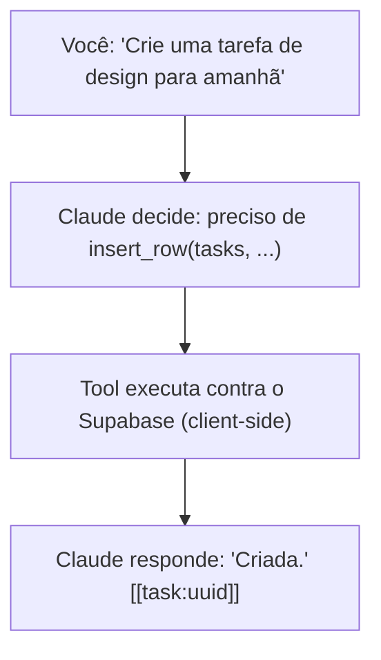

# Khaos — Integração com IA

## Como funciona

A IA conversa em linguagem natural e age no banco via **tool use** —
ferramentas genéricas de leitura/escrita, não uma ferramenta por entidade.
Um único modelo (Claude) é usado; as integrações antigas com Gemini e
DeepSeek foram descontinuadas junto com o backend FastAPI que as hospedava.

Não existe um backend próprio que execute as tools — elas rodam no mesmo
processo que fez a chamada ao modelo: no navegador para o chat do app
(`src/lib/chat`), ou dentro da Edge Function `telegram-bot` para o Telegram.
Ambos compartilham o mesmo núcleo de código (ver
[Dois front-ends, um cérebro](#dois-front-ends-um-cérebro)).

## Modelo

- Modelo: `claude-sonnet-5` (configurável via `VITE_LLM_MODEL` no app,
  `LLM_MODEL` na Edge Function do Telegram)
- O oversight agent (análise em segundo plano) usa `claude-haiku-4-5` por
  padrão, configurável via `OVERSIGHT_LLM_MODEL`
- Tool use nativo via `@anthropic-ai/sdk`, chamado diretamente do client —
  não há wrapper próprio de protocolo

A chave `ANTHROPIC_API_KEY` nunca chega ao navegador: o SDK do Anthropic é
apontado (`baseURL`) para a Edge Function `anthropic-proxy`, que injeta a
chave do lado do servidor e repassa a chamada para `api.anthropic.com`. Ver
[`anthropic-proxy`](#anthropic-proxy) abaixo.

## Arquivos (app web)

| Arquivo | Responsabilidade |
| --- | --- |
| `src/lib/chat/client.ts` | Cria o client Anthropic apontado para o proxy; reexporta os prompts |
| `src/lib/chat/prompts.ts` | `TONE_INSTRUCTION` (persona) e `SYSTEM_INSTRUCTION` (regras de domínio) — puro texto, sem imports, compartilhado com o bot do Telegram (Deno) |
| `src/lib/chat/agent.ts` | Loop de turno: monta o system prompt (com cache), envia ao modelo, executa tool calls, acumula histórico até 6 rodadas de tool use por turno |
| `src/lib/chat/toolsCore.ts` | Schemas das tools, coerção de argumentos, o executor (`executeTool`) — framework-agnóstico, sem imports de runtime, compartilhado com o Telegram |
| `src/lib/chat/tools.ts` | Injeta o client Supabase (anon key) e `searchSchema` no núcleo acima, para uso no browser |
| `src/lib/chat/schemaSearch.ts` / `schemaSearchCore.ts` | Busca por palavra-chave no schema do banco (tabelas, colunas, enums, RPCs) — power por trás da tool `search_schema` |
| `src/lib/chat/entityRefs.ts` | Extrai/injeta os tokens `[[task:uuid]]` etc. usados para renderizar cards inline |
| `src/lib/chat/history.ts` | Leitura/escrita do histórico de conversa (`chat_history`, compartilhado com o Telegram) |
| `src/lib/chat/chatActivityContext.tsx` | Contexto React para estado de atividade do chat (badge de mensagem não vista — opener ou nudge reativo) |
| `src/hooks/useChatAgent.ts` | Hook que orquestra `runTurn`, injeta contexto temporal/UI na mensagem do usuário, sincroniza com `chat_history` e monta o turno silencioso de reação a mudanças de banco |
| `src/lib/chat/changeWatcher.ts` | Lógica pura (testada, ver `changeWatcher.test.ts`) de buffering/gate/cooldown/formatação do watcher reativo de mudanças de banco — sem imports de runtime |
| `src/hooks/useDbChangeFeed.ts` | Liga `changeWatcher.ts` a uma subscription Realtime em `moments` (com fallback de poll) e ao turno de chat |

## System prompt

`prompts.ts` define duas seções, montadas em `agent.ts` dentro de
`<system_instructions>` / `<tone_and_behavior>` e marcadas com
`cache_control: ephemeral` para acionar prompt caching (o texto precisa ser
byte-a-byte idêntico entre chamadas — contexto variável como data/hora vai
na mensagem do usuário, não no system prompt).

- **`TONE_INSTRUCTION`** — persona: calma, observadora, concisa; nunca
  reivindica uma ação como concluída sem que a tool correspondente tenha
  tido sucesso; regras de quando elaborar vs. responder em uma palavra;
  regras de abertura de sessão.
- **`SYSTEM_INSTRUCTION`** — regras de domínio: hierarquia
  field→project→section→task, uso de `ilike` para busca por nome, `due` vs.
  `target`, como tratar `task_logs` (foreground/background), o toggle
  "marcado para hoje" (moments `today`/`notToday`), obrigatoriedade do
  parâmetro `reason` ao mudar status/prioridade/due/estimate, o formato
  dos tokens `[[task:uuid]]` / `[[project:uuid]]` / `[[event:uuid]]` que a
  UI renderiza como cards, o prefixo `[UI Context: ...]` que a interface
  injeta (ver `useChatAgent.ts`) como sinal de onde alocar uma tarefa nova, e
  a regra de propor colocação/estimativa (`suggest_task_placement`/
  `suggest_task_estimate`) antes de criar uma tarefa sem projeto/seção
  explícitos.

## Tools disponíveis

Ao contrário da versão original do sistema (uma tool por operação de cada
entidade — `create_task`, `update_project` etc.), a IA hoje opera com um
conjunto pequeno e genérico de ferramentas do tipo SQL:

### Leitura

| Tool | Descrição |
| --- | --- |
| `search_schema` | Busca por palavra-chave no schema (tabelas, colunas, enums, RPCs) |
| `query_rows` | `SELECT` genérico — tabela, `select`, `filters` (coluna/operador/valor), `orderBy`, `limit` |
| `list_tasks_marked_for_day` | Deriva quais tarefas estão "marcadas para hoje" (ou outro dia) a partir dos moments `today`/`notToday` — evita reimplementar essa lógica via `query_rows` bruto |
| `suggest_task_placement` | Devolve a hierarquia ativa (field→project→section, com contagem de tarefas abertas e última atividade por seção/projeto) para a IA escolher onde colocar uma tarefa nova sem projeto/seção informados — sem score lexical, o casamento pelo nome é feito pelo próprio modelo |
| `suggest_task_estimate` | Sugere um `estimate` em minutos a partir de `task_logs` reais de tarefas comparáveis (mesma seção → mesmo projeto → `work_tag` em comum → palavras do nome), com mediana/média e a base usada, ou `{basis:'none', n:0}` quando não há histórico |
| `suggest_next_task` | Dado o id de uma tarefa recém-assentada (ex: marcada `done`), devolve candidatos ranqueados para a próxima: sucessor desbloqueado em `tasks_sequence` → irmã aberta na mesma seção → tarefa com `work_tag` em comum → cabeça da fila `backlog_rank`, parando no primeiro nível com resultado, ou `{basis:'none', n:0}` |

### Escrita

| Tool | Descrição |
| --- | --- |
| `insert_row` | Insere uma linha em qualquer tabela permitida |
| `update_rows` | Atualiza linhas que casam com `filters` |
| `delete_rows` | Remove linhas que casam com `filters` (a IA é instruída a preferir soft delete via `deleted_at` quando a coluna existe) |
| `call_rpc` | Chama qualquer função RPC exposta pelo Supabase (ex: `stop_active_task`, `stop_task_log`) |

### Oversight

| Tool | Descrição |
| --- | --- |
| `recall_oversight_notes` | Lê notas geradas em segundo plano pelo oversight agent — padrões notados em lotes de moments, não só no que aconteceu nesta conversa |

Tabelas permitidas (`ALLOWED_TABLES` em `toolsCore.ts`): `fields`, `projects`,
`sections`, `tasks`, `task_items`, `task_logs`, `events`, `routines`,
`moments`, `moment_tags`, `work_tags`, `moment_tag_entities`,
`work_tag_entities`, `sections_sequence`, `tasks_sequence`.

`insert_row`/`update_rows` aceitam um parâmetro opcional `reason` — a
justificativa é anexada como `moment_note` ao moment que o próprio trigger
do banco já criou para essa mudança (`authored_by: 'assistant'`), fechando o
requisito de sempre documentar o contexto de uma mudança de status,
prioridade, due ou estimate.

`toolsCore.ts` também normaliza uma boa quantidade de variações que o
modelo emite na prática: nomes de tool alternativos (`update_row` →
`update_rows`), `filters`/`values` chegando como string JSON em vez de
array/objeto, `filters` chegando como mapa `{coluna: valor}` em vez de lista
de `{column, operator, value}`, `limit`/`ascending` como string.

## Reagindo a mudanças de banco fora do chat

Antes desta seção, a IA só "via" o que acontecia dentro da própria
conversa (ou, com ~15min de atraso e filtro de "digno de nota", via o
oversight agent). Marcar uma tarefa `done` no `TaskDetailModal`, por
exemplo, não chegava ao modelo de nenhuma forma. `src/lib/chat/
changeWatcher.ts` (lógica pura, testada) + `src/lib/chat/momentFeed.ts`
(fiação com o Supabase, injetável) + `src/hooks/useDbChangeFeed.ts` (liga as
duas) fecham esse requisito:

1. **Fonte**: `moments` está na publicação `supabase_realtime`; cada chamada
   de `subscribeToMomentFeed` (`momentFeed.ts`) assina `postgres_changes`
   (INSERT) nessa tabela num tópico Realtime **próprio**
   (`'db-change-feed-<n>'`, contador de módulo) — nunca o mesmo tópico fixo
   entre instâncias, porque `RealtimeClient.channel()` reaproveita um canal
   já existente para o mesmo tópico e `.on()` lança erro nesse canal
   reaproveitado se ele já estiver inscrito; isso já derrubou o app inteiro
   quando duas instâncias de `ChatPanel` (rail + bottom-sheet, ou rail +
   `/assistant`) compartilhavam o tópico — ver [Chat do assistente derruba o
   app ao abrir no mobile](backlog.md#chat-do-assistente-derruba-o-app-ao-abrir-no-mobile).
   Se a subscription não chegar a `SUBSCRIBED` em alguns segundos (Realtime
   pode estar desligado no projeto), ele cai para polling a cada 60s —
   degrada em vez de ficar mudo para sempre.
2. **Atribuição**: linhas com `authored_by = 'assistant'` são descartadas
   antes de qualquer outra coisa (ver `stampAssistantMoments` em
   `toolsCore.ts`, [Database](01-database.md#moments)) — sem isso o watcher
   reagiria à própria escrita do assistente. Como a UPDATE que corrige
   `authored_by` roda *depois* do INSERT original (outra viagem de rede),
   o hook também suprime tudo que chegar enquanto um turno de chat está em
   voo, mais uma pequena janela de graça depois dele — é essa janela, não
   o filtro por `authored_by`, que fecha a corrida real.
3. **Buffer**: um lote de moments (um "marcar done" cascateia em vários)
   espera ~8s de silêncio antes de ser considerado fechado
   (`ChangeBuffer`).
4. **Gate determinístico**: antes de qualquer chamada ao modelo, o lote só
   segue se tiver pelo menos um moment "digno" — `status` → `done`/
   `cancelled`, `created`, `today`, `backlog`, `deleted`
   (`isNudgeWorthy`). `due`/`priority`/`renamed`/`moved`/`item`/`note` não
   disparam por si, mas viajam no resumo se estiverem no mesmo lote.
5. **Taxa**: cooldown entre nudges (`VITE_NUDGE_COOLDOWN_MINUTES`, default
   10min) e um teto por hora (`canNudge`).
6. **Disparo único**: antes de rodar o turno, o hook tenta inserir o id do
   último moment do lote em `assistant_nudges`; erro de chave duplicada
   significa que outra aba/instância já assumiu aquele lote exato — mesma
   ideia de idempotência de `telegram_notifications`.
7. **Turno**: `useChatAgent.ts` roda um turno silencioso
   (`runWithUserContent(..., {silent:true})`) com um prefixo
   `[DB Change: ...]` (ver `formatDbChangePrefix`) — tipo+id da entidade,
   tipo do moment, transição anterior→novo, autor. O prompt
   (`REACTING TO DATABASE CHANGES` em `prompts.ts`) autoriza explicitamente
   responder com nada, e instrui a propor uma próxima ação concreta (via
   `suggest_next_task`) em vez de narrar a mudança de volta. Se o modelo
   responder com texto, o badge de mensagem não vista acende
   (`markAssistantUnseen`), igual ao opener de sessão.

## Adicionando uma nova tool

1. Adicione o schema em `READ_TOOL_DEFINITIONS`, `WRITE_TOOL_DEFINITIONS` ou
   `OVERSIGHT_TOOL_DEFINITIONS` em `toolsCore.ts`
2. Adicione o `case` correspondente em `executeTool`
3. Se a tool precisa ser usada pelo bot do Telegram também, nada extra é
   necessário — `toolsCore.ts` é compartilhado

## Dois front-ends, um cérebro

`src/lib/chat/*` (persona, schemas de tool, executor) é importado tanto pelo
app web quanto pela Edge Function `telegram-bot`
(`supabase/functions/_shared`), então os dois nunca divergem de
comportamento. O que muda entre eles:

| | App web | Telegram bot |
| --- | --- | --- |
| Chamada ao Claude | via Edge Function `anthropic-proxy` | direta, com `ANTHROPIC_API_KEY` |
| Client Supabase | anon key | service-role key |
| Confirmação de escrita | interativa na UI | nenhuma (bot single-owner atrás de allowlist) |
| Histórico | `chat_history` (compartilhado com o Telegram) | mesmo `chat_history` |

## Edge Functions

### `anthropic-proxy`

Reverse proxy que injeta `ANTHROPIC_API_KEY` do lado do servidor e repassa a
chamada para `api.anthropic.com`. `verify_jwt` fica desligado
(`supabase/config.toml`) porque o gateway bloquearia o preflight CORS antes
de a função rodar; em vez disso, a própria função valida
`Authorization: Bearer <supabase anon/publishable key>` manualmente.

### `telegram-bot`

Webhook do Telegram — responde mensagens com o mesmo agente/persona/tools do
app web. Client Supabase com service-role key, sem passo de confirmação de
escrita (allowlist de chat ids via `TELEGRAM_ALLOWED_CHAT_IDS`). Comandos:
`/start`, `/clear`, `/reset` (limpam o histórico), `/whoami` (retorna o chat
id, usado para configurar o allowlist inicialmente).

### `telegram-notify`

Disparada por cron, envia:

- **`digest`** — resumo matinal (atrasadas, vencem hoje, agenda do dia,
  janelas `scheduled` que passaram sem conclusão, `target` vencido,
  importantes não agendadas). Sugestões de ação ficam pendentes até o
  usuário responder aprovando.
- **`reminders`** — lembrete determinístico (sem chamada ao modelo) alguns
  minutos antes de um evento `scheduled` começar
  (`REMINDER_LEAD_MINUTES`, default 10).

Idempotente via `telegram_notifications`.

### `oversight-agent`

Rodando em cron (ex: a cada 15 min), varre `moments` desde o último cursor
salvo em `oversight_cursor`, agrupa em lotes por entidade e — quando um lote
é "digno de nota" (mais de um moment relacionado, ou um moment de tipo
`note`/`priority`/`status` sozinho) — pede a um modelo mais barato
(`claude-haiku-4-5` por padrão) um resumo curto, salvo em `oversight_notes`.
Só leitura para o chat interativo, via `recall_oversight_notes`; não existe
UI dedicada para essas notas.
